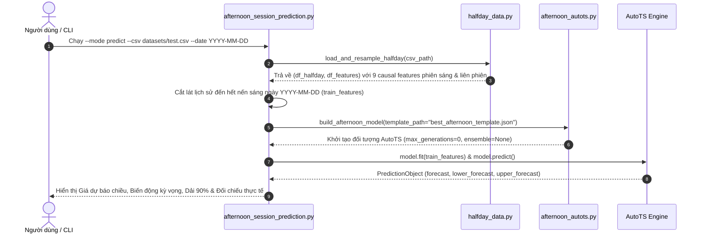
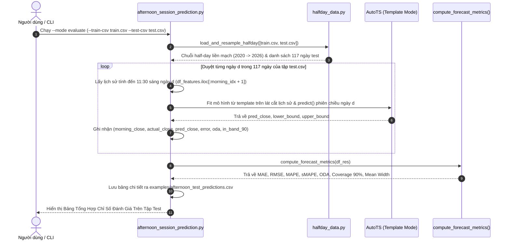

# Cấu Trúc Dự Án (Project Structure & Architecture)

Tài liệu này mô tả toàn cảnh kiến trúc kỹ thuật, cấu trúc cây thư mục, trách nhiệm của từng thành phần và các luồng xử lý dữ liệu chính trong dự án **AutoTS4PS** (*Automated Time Series Forecasting for Derivatives / VN30F1M*).

---

## 1. Tổng Quan Kiến Trúc (Architecture Overview)

**AutoTS4PS** là nền tảng dự báo chuỗi thời gian tự động (Automated Time Series Forecasting) quy mô lớn bằng thuật toán di truyền (Genetic Programming), được tối ưu hóa chuyên biệt cho dữ liệu tài chính và phái sinh chỉ số chứng khoán (**VN30F1M**):

- **Genetic AutoML Search & Multi-Metric Optimization:** Tự động tìm kiếm sự kết hợp tối ưu giữa chuỗi phép biến đổi tiền xử lý (`Transformers`), mô hình dự báo (`Models`: Statistical, Machine Learning, Motif, State-Space, Deep Learning) và kỹ thuật kết hợp mô hình (`Ensembles`: BestN, Horizontal, Mosaic,MLEnsemble).
- **Causal Financial Forecasting (Zero Look-Ahead Bias):** Tích hợp bộ lọc biến đổi nhân quả một chiều (`DifferencedTransformer`, `PctChangeTransformer`, `RobustScaler`, `EWMAFilter`, `AlignLastValue`) và trích xuất đặc trưng phiên sáng (`halfday_data.py`) giúp triệt tiêu hoàn toàn hiện tượng rò rỉ dữ liệu tương lai (Repainting / Data Leakage).
- **Template Export & Sub-Second Fast Inference:** Cho phép lưu cấu hình mô hình tốt nhất từ tập huấn luyện (`datasets/train.csv`) ra tệp JSON (`best_afternoon_template.json`) và chạy dự báo/kiểm định walk-forward tốc độ cao (~0.4 giây/phiên) trên tập kiểm thử (`datasets/test.csv`).
- **Time-Varying Alignment (TVA) & Feature/Anomaly Detection:** Cung cấp hệ thống căn chỉnh cấu trúc đa chuỗi thời gian (`evaluator/tva/`), phát hiện điểm gãy xu hướng (`changepoints`), dị thường (`anomaly_detector`) và sự kiện rủi ro (`event_forecasting`).

```mermaid
flowchart TD
    subgraph DataLayer ["1. Tầng Dữ Liệu (Datasets & Resampling)"]
        RawCSV["Dữ liệu Nến 5m VN30F1M\n(datasets/train.csv, datasets/test.csv)"]
        HalfdayTool["Module Nén Half-Day & Đặc Trưng Nhân Quả\n(src/autots/tools/halfday_data.py)"]
        SyntheticData["Bộ Sinh Dữ Liệu Giả Lập & Mẫu\n(src/autots/datasets/)"]
    end

    subgraph CoreEngine ["2. Lõi AutoTS4PS (src/autots/)"]
        Transformers["Chuỗi Biến Đổi Nhân Quả (tools/transform.py)\nDifferenced, PctChange, RobustScaler, EWMA, AlignLastValue"]
        ModelPool["Kho Mô Hình Dự Báo (models/)\nVAR, VECM, RollingRegression, WindowRegression,\nBallTreeMultivariateMotif, Cassandra, TVA, TiDE, DeepSSM"]
        Evaluator["Bộ Đánh Giá & Tìm Kiếm Di Truyền (evaluator/auto_ts.py)\nCross-Validation, Metric Weighting (DWAE, ODA, SPL, MAE, RMSE)"]
        TemplateJSON["Template Cấu Hình Tối Ưu\n(examples/best_afternoon_template.json)"]
    end

    subgraph Applications ["3. Ứng Dụng & Giao Tiếp (examples/ & mcp/)"]
        PredictMode["Dự Báo Phiên Chiều (--mode predict)\nPoint Forecast, Biến động kỳ vọng, Dải tin cậy 90%"]
        EvalMode["Đánh Giá Tập Test (--mode evaluate)\nWalk-Forward 117 phiên: MAE, RMSE, MAPE, sMAPE, ODA, Coverage 90%"]
        MCPServer["MCP Server (src/autots/mcp/)\nTích hợp công cụ dự báo cho AI Agents"]
    end

    RawCSV --> HalfdayTool
    HalfdayTool --> Transformers
    SyntheticData --> Transformers
    Transformers --> ModelPool
    ModelPool <--> Evaluator
    Evaluator -->|Export Best Model (n=1)| TemplateJSON
    TemplateJSON -->|Fast Inference (~0.4s)| PredictMode
    TemplateJSON -->|Walk-Forward Evaluation| EvalMode
    CoreEngine --> MCPServer
```

---

## 2. Cây Thư Mục Toàn Dự Án (Directory Layout)

```text
autots4ps/
├── datasets/                           # Dữ liệu chuỗi thời gian thực tế (VN30F1M khung 5 phút)
│   ├── train.csv                       # Tập huấn luyện (02/01/2020 – 31/12/2025)
│   ├── test.csv                        # Tập kiểm thử độc lập (05/01/2026 – 26/06/2026, 117 phiên)
│   └── VN30F1M_5m.csv                  # Bộ dữ liệu tổng hợp gốc khung 5 phút
├── src/                                # Mã nguồn chính của thư viện (Package Layout)
│   └── autots/
│       ├── __init__.py                 # Điểm xuất (Exports) các class/hàm lõi của thư viện
│       ├── datasets/                   # Bộ nạp dữ liệu mẫu & trình tạo dữ liệu tổng hợp
│       │   ├── _base.py                # Hàm nạp các tập dữ liệu chuẩn (daily, hourly, fred, sine...)
│       │   ├── synthetic.py            # Trình sinh dữ liệu chuỗi thời gian giả lập có nhãn
│       │   └── data/                   # Các tệp dữ liệu nén phục vụ kiểm thử nội bộ
│       ├── evaluator/                  # Bộ điều phối AutoML, đánh giá mô hình & phát hiện đặc trưng
│       │   ├── auto_ts.py              # Class AutoTS: điều phối Genetic Search, Validation, Template I/O
│       │   ├── auto_model.py           # Hàm model_forecast, TemplateWizard, Backwards/Seasonal Validation
│       │   ├── metrics.py              # Hệ thống hàm đo lường sai số (MAE, RMSE, sMAPE, SPL, ODA, DWAE...)
│       │   ├── validation.py           # Xác thực và chuẩn hóa tham số kiểm định chéo
│       │   ├── anomaly_detector.py     # Phát hiện điểm dị thường (Anomaly Detection) và ngày lễ
│       │   ├── event_forecasting.py    # Dự báo rủi ro sự kiện vượt ngưỡng (Event Risk Forecasting)
│       │   ├── benchmark.py            # Đo kiểm tốc độ và hiệu năng mô hình
│       │   ├── feature_detector/       # Tự động nhận diện Trend, Seasonality, Changepoints, Anomalies
│       │   └── tva/                    # Kiến trúc Time-Varying Alignment (Anchors, Graph, Factor, Priors)
│       ├── models/                     # Kho thuật toán dự báo chuỗi thời gian
│       │   ├── afternoon_autots.py     # Cấu hình AutoTS chuyên biệt cho dự báo phiên chiều VN30F1M
│       │   ├── base.py                 # Class cơ sở ModelObject & PredictionObject
│       │   ├── model_list.py           # Phân nhóm danh sách mô hình (fast, default, probabilistic, multilingual...)
│       │   ├── basics.py               # Các mô hình cơ sở & Motif (LastValueNaive, SeasonalNaive, BallTreeMultivariateMotif...)
│       │   ├── statsmodels.py          # Mô hình kinh tế lượng (VAR, VECM, ARIMA, ETS, GLM, GLS, ARDL)
│       │   ├── sklearn.py              # Mô hình học máy (RollingRegression, WindowRegression, DatepartRegression, MultivariateRegression)
│       │   ├── ensemble.py             # Thuật toán tổ hợp mô hình (BestN, Horizontal, Mosaic)
│       │   ├── mlensemble.py           # Tổ hợp mô hình học máy đa tầng
│       │   ├── cassandra.py            # Mô hình phân rã cấu trúc chuỗi thời gian Cassandra
│       │   ├── cassandra_ar.py         # Biến thể tự hồi quy Cassandra AR
│       │   ├── matrix_var.py           # Mô hình Matrix Autoregressive (MAR, RRVAR)
│       │   ├── arch.py                 # Mô hình biến động phương sai có điều kiện (ARCH/GARCH)
│       │   ├── deepssm.py              # Mô hình không gian trạng thái học sâu (Deep State Space Model)
│       │   ├── tva_model.py            # Mô hình dự báo tích hợp Time-Varying Alignment
│       │   ├── tide.py                 # Time-series Dense Encoder (TiDE)
│       │   ├── pytorch.py              # Wrapper cho PyTorch Forecasting
│       │   ├── neural_forecast.py      # Wrapper cho NeuralForecast
│       │   ├── gluonts.py              # Wrapper cho GluonTS
│       │   ├── prophet.py              # Wrapper cho Meta Prophet
│       │   └── dnn.py                  # Mạng nơ-ron sâu (DNN) cơ bản
│       ├── tools/                      # Công cụ biến đổi dữ liệu, lọc tín hiệu & tiện ích toán học
│       │   ├── halfday_data.py         # Nén dữ liệu 5m thành 2 phiên Sáng/Chiều & tạo 9 đặc trưng nhân quả
│       │   ├── decision_engine.py      # Bộ tính toán xác suất và biên độ biến động
│       │   ├── transform.py            # Hơn 35 bộ biến đổi chuỗi thời gian (GeneralTransformer & các Transformer con)
│       │   ├── impute.py               # Điền khuyết dữ liệu chuỗi thời gian (FillNA)
│       │   ├── regressor.py            # Tạo biến ngoại sinh (create_lagged_regressor, create_regressor)
│       │   ├── seasonal.py             # Trích xuất đặc trưng thời gian, Fourier, Datepart
│       │   ├── holiday.py              # Nhận diện ngày lễ, lịch giao dịch
│       │   ├── lunar.py                # Chuyển đổi lịch âm (Lunar Calendar)
│       │   ├── changepoints.py         # Thuật toán phát hiện điểm đảo chiều/thay đổi cấu trúc
│       │   ├── kalman.py               # Bộ lọc Kalman tiêu chuẩn
│       │   ├── fast_kalman.py          # Bộ lọc Kalman tối ưu tốc độ cao
│       │   ├── cointegration.py        # Kiểm định đồng liên kết (Johansen, Engle-Granger)
│       │   ├── wavelet.py              # Biến đổi Wavelet
│       │   ├── fft.py                  # Biến đổi Fourier nhanh (Fast Fourier Transform)
│       │   ├── fir_filter.py           # Bộ lọc đáp ứng xung hữu hạn (FIR Filter)
│       │   ├── constraint.py           # Áp đặt ràng buộc biên trên/dưới, làm tròn và chống âm cho dự báo
│       │   ├── percentile.py           # Tính toán phân vị nhanh trên mảng đa chiều
│       │   └── plotting.py             # Trực quan hóa dự báo và chẩn đoán mô hình
│       ├── templates/                  # Các template mẫu mặc định của AutoTS
│       └── mcp/                        # Máy chủ Model Context Protocol (MCP Server)
│           └── server.py               # Cung cấp công cụ dự báo, tiền xử lý, phát hiện đặc trưng qua giao thức MCP
├── examples/                           # Các kịch bản ứng dụng thực tế và đánh giá chuẩn (Benchmarks)
│   ├── afternoon_session_prediction.py # Script dự báo phiên chiều & đánh giá chỉ số walk-forward trên tập test
│   ├── best_afternoon_template.json    # Template mô hình tối ưu nhất xuất từ tập train
│   ├── afternoon_test_predictions.csv  # Kết quả chi tiết dự báo trên 117 phiên của tập test.csv
│   ├── detector_trend_forecast_eval.py # Đánh giá bộ phát hiện xu hướng và dự báo
│   ├── synthetic_tuning_example.py     # Ví dụ tinh chỉnh siêu tham số trên dữ liệu tổng hợp
│   ├── tva_benchmark.py                # Kịch bản đánh giá kiến trúc TVA
│   └── README.md                       # Hướng dẫn chạy các ví dụ trong thư mục examples/
├── tests/                              # Hệ thống kiểm thử tự động (Unit & Integration Tests)
│   ├── test_afternoon_data.py          # Kiểm thử nén dữ liệu Sáng/Chiều và trích xuất đặc trưng nhân quả
│   ├── test_afternoon_model.py         # Kiểm thử cấu hình AutoTS và whitelist transformers
│   ├── test_afternoon_script.py        # Kiểm thử luồng dự báo đơn lẻ, đánh giá tập test và hàm tính metrics
│   ├── test_afternoon_decision.py      # Kiểm thử tính toán xác suất và biên độ
│   ├── test_autots.py                  # Kiểm thử toàn diện luồng AutoTS chính
│   ├── test_metrics.py                 # Kiểm thử các chỉ số đánh giá sai số
│   ├── test_transforms.py              # Kiểm thử các phép biến đổi tiền xử lý
│   └── ...                             # Hơn 30 tệp kiểm thử chuyên biệt cho từng mô hình & công cụ
├── docs/                               # Tài liệu kỹ thuật và thiết kế
│   ├── afternoon_session_prediction.md # Tài liệu chi tiết dự báo phiên chiều & báo cáo chỉ số tập test
│   ├── superpowers/                    # Hồ sơ thiết kế (Specs) và kế hoạch triển khai (Plans)
│   └── .ai/                            # Quy chuẩn kỹ thuật dành cho AI Agents & Lập trình viên
│       ├── STRUCTURE.md                # Tài liệu cấu trúc dự án (File này)
│       ├── GIT_CONVENTIONS.md          # Quy chuẩn commit và quản lý nhánh Git
│       ├── RULE.md                     # Quy tắc mã hóa và kiểm soát chất lượng
│       └── AI_AGENT_GUIDELINE.md       # Hướng dẫn quy trình làm việc của AI Agent
├── scripts/                            # Kịch bản tiện ích tự động hóa
│   └── generate_agents_markdown.sh     # Đồng bộ tài liệu từ docs/.ai/
├── pyproject.toml                      # Cấu hình đóng gói Python (setuptools) và quản lý phụ thuộc (uv)
├── uv.lock                             # Khóa phiên bản thư viện đảm bảo tính tái lập (Reproducibility)
└── README.md                           # Tổng quan dự án AutoTS4PS
```

---

## 3. Trách Nhiệm Chi Tiết Của Các Thành Phần Cốt Lõi

### 3.1. Bộ Điều Phối & Đánh Giá (`src/autots/evaluator/`)
- **[`auto_ts.py`](file:///home/v002353/Desktop/SN/04.%20TPO/autots4ps/src/autots/evaluator/auto_ts.py)**:
  - Cung cấp lớp chính `AutoTS` điều phối toàn bộ vòng đời huấn luyện: chuẩn hóa dữ liệu đầu vào (`wide`/`long`), khởi tạo quần thể mô hình ban đầu (`initial_template`), tiến hóa qua nhiều thế hệ (`max_generations`), kiểm định chéo (`num_validations` theo phương thức `backwards`, `even`, `seasonal`, `similarity`), lựa chọn mô hình tốt nhất dựa trên `metric_weighting` và xuất/nhập cấu hình (`export_template`, `import_template`).
- **[`auto_model.py`](file:///home/v002353/Desktop/SN/04.%20TPO/autots4ps/src/autots/evaluator/auto_model.py)**:
  - Chứa hàm lõi `model_forecast()` thực thi một pipeline hoàn chỉnh gồm: Điền khuyết (`FillNA`) $\rightarrow$ Biến đổi thuận (`Transformation.fit_transform`) $\rightarrow$ Huấn luyện mô hình (`Model.fit`) $\rightarrow$ Sinh dự báo (`Model.predict`) $\rightarrow$ Biến đổi ngược về thang đo gốc (`Transformation.inverse_transform`).
- **[`metrics.py`](file:///home/v002353/Desktop/SN/04.%20TPO/autots4ps/src/autots/evaluator/metrics.py)**:
  - Cung cấp các hàm tính toán sai số đa chiều trên cả điểm dự báo (Point Forecast) và khoảng dự báo (Upper/Lower Bounds): `mae`, `rmse`, `smape`, `spl` (Scaled Pinball Loss), `oda` (Origin Direction Accuracy), `dwae` (Directional Weighted Absolute Error), `contour`, `wasserstein`.

### 3.2. Kho Mô Hình & Cấu Hình Phái Sinh (`src/autots/models/`)
- **[`afternoon_autots.py`](file:///home/v002353/Desktop/SN/04.%20TPO/autots4ps/src/autots/models/afternoon_autots.py)**:
  - Hàm `build_afternoon_model(fast_mode, template_path)` cấu hình `AutoTS` chuyên biệt cho bài toán dự báo giá đóng cửa phiên chiều VN30F1M (`forecast_length=1`, `prediction_interval=0.90`).
  - Áp dụng danh sách trắng (Whitelist) các phép biến đổi nhân quả 1 chiều và tự động tắt việc sinh thêm ứng viên ensemble dư thừa (`ensemble=None`) khi nạp từ `template_path` để đạt tốc độ suy luận ~0.4 giây/phiên.
- **[`base.py`](file:///home/v002353/Desktop/SN/04.%20TPO/autots4ps/src/autots/models/base.py)**:
  - Định nghĩa `ModelObject` (giao diện chuẩn cho mọi thuật toán dự báo) và `PredictionObject` (chứa `forecast`, `lower_forecast`, `upper_forecast` kèm metadata của mô hình và biến đổi).

### 3.3. Công Cụ Tiền Xử Lý & Dữ Liệu Bán Nhật (`src/autots/tools/`)
- **[`halfday_data.py`](file:///home/v002353/Desktop/SN/04.%20TPO/autots4ps/src/autots/tools/halfday_data.py)**:
  - Hàm `load_and_resample_halfday(csv_path, max_days)` hỗ trợ đọc một tệp CSV, danh sách nhiều tệp CSV (`[train.csv, test.csv]`) hoặc `pd.DataFrame`.
  - Gom cụm dữ liệu 5 phút thành 2 thanh nến mỗi ngày: **Sáng** (09:00–11:30) và **Chiều** (13:00–14:45).
  - Tính toán 9 đặc trưng nhân quả từ phiên sáng và liên phiên (`ret_morning`, `norm_atr`, `vwap_dev`, `vol_ratio`, `ret_last30m`, `morning_clv`, `overnight_gap`, `prev_afternoon_ret`, `prev_ret_morning`) và gán trục thời gian tuần tự đều đặn (`freq="12h"`) để loại bỏ khoảng trống nghỉ trưa, qua đêm và cuối tuần.
- **[`transform.py`](file:///home/v002353/Desktop/SN/04.%20TPO/autots4ps/src/autots/tools/transform.py)**:
  - Cung cấp lớp `GeneralTransformer` kết nối chuỗi tối đa $N$ bước biến đổi (Detrending, Scaling, Filtering, Clipping, Discretization) có khả năng đảo ngược (`inverse_transform`) chính xác cho cả dự báo điểm và biên trên/dưới.

### 3.4. Ứng Dụng Dự Báo & Đánh Giá Tập Test (`examples/afternoon_session_prediction.py`)
- **[`afternoon_session_prediction.py`](file:///home/v002353/Desktop/SN/04.%20TPO/autots4ps/examples/afternoon_session_prediction.py)**:
  - **`compute_forecast_metrics(df_res)`**: Tính toán bộ 7 chỉ số đánh giá dự báo chuỗi thời gian tiêu chuẩn: `MAE`, `RMSE`, `MAPE (%)`, `sMAPE (%)`, `ODA (%)`, `Coverage 90% (%)`, và `Mean Interval Width`.
  - **`run_predict(csv_path, target_date, fast_mode)`** (`--mode predict`): Dự báo giá đóng cửa phiên chiều tại thời điểm 11:30 trưa cho một ngày cụ thể và đối chiếu sai số với kết quả thực tế.
  - **`run_evaluate(train_csv_path, test_csv_path, n_days, fast_mode, output_csv)`** (`--mode evaluate`): Nối lịch sử từ `datasets/train.csv`, chạy walk-forward dự báo từng phiên chiều trên toàn bộ `datasets/test.csv`, in bảng tổng hợp chỉ số định lượng và xuất kết quả chi tiết ra `examples/afternoon_test_predictions.csv`.

---

## 4. Các Luồng Dữ Liệu Chính (Core Data Flows)

### 4.1. Luồng Dự Báo Phiên Chiều Đơn Lẻ (`--mode predict`)



### 4.2. Luồng Đánh Giá Walk-Forward Trên Tập Test (`--mode evaluate`)



---

## 5. Quy Chuẩn Phát Triển & Kiểm Thử (Development & Testing Workflow)

- **Môi trường & Quản lý gói:** Sử dụng `Python >= 3.12` và `uv` (`uv run ...`).
- **Chạy kiểm thử tự động (Unit Tests):**
  ```bash
  # Kiểm thử toàn bộ các module dự báo phiên chiều
  uv run python -m unittest discover tests/ "test_afternoon_*.py"

  # Kiểm thử khả năng nạp gói và bí danh tương thích
  uv run python -m unittest tests/test_package_imports.py
  ```
- **Chạy đánh giá chuẩn trên tập Test:**
  ```bash
  uv run python examples/afternoon_session_prediction.py --mode evaluate
  ```
