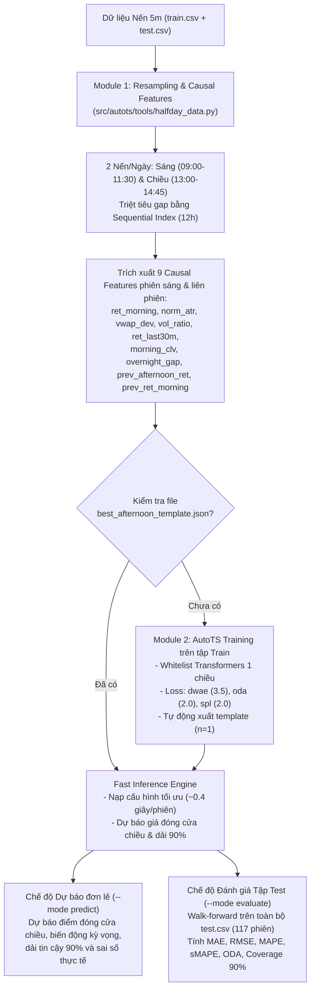

# Tài Liệu Kỹ Thuật: Dự Báo Giá Đóng Cửa Phiên Chiều & Đánh Giá Tập Test VN30F1M (Afternoon Session Prediction)

> **File thực thi chính:** [`examples/afternoon_session_prediction.py`](file:///home/v002353/Desktop/SN/04.%20TPO/autots4ps/examples/afternoon_session_prediction.py)  
> **Cấu hình Template:** [`examples/best_afternoon_template.json`](file:///home/v002353/Desktop/SN/04.%20TPO/autots4ps/examples/best_afternoon_template.json)  
> **Kết quả dự báo chi tiết tập Test:** [`examples/afternoon_test_predictions.csv`](file:///home/v002353/Desktop/SN/04.%20TPO/autots4ps/examples/afternoon_test_predictions.csv)  
> **Bộ dữ liệu mẫu:** [`datasets/train.csv`](file:///home/v002353/Desktop/SN/04.%20TPO/autots4ps/datasets/train.csv) (2020–2025), [`datasets/test.csv`](file:///home/v002353/Desktop/SN/04.%20TPO/autots4ps/datasets/test.csv) (2026)  

---

## 1. Giới Thiệu & Bối Cảnh (Overview & Market Context)

Trong giao dịch Hợp đồng tương lai chỉ số VN30 (VN30F1M), phiên giao dịch trong ngày gồm 2 nửa tách biệt bởi khoảng nghỉ trưa 90 phút (11:30 – 13:00):
- **Phiên sáng (09:00 – 11:30):** Hấp thụ thông tin mở cửa ATO và diễn biến thị trường buổi sáng.
- **Giờ nghỉ trưa (11:30 – 13:00):** Khoảng lặng cho phép chạy mô hình dự báo chuỗi thời gian trước khi phiên chiều bắt đầu.
- **Phiên chiều (13:00 – 14:45):** Quyết định mức giá đóng cửa trong ngày tại 14:45.

Hệ thống thực hiện **dự báo chuỗi thời gian thuần túy (Standard Time-Series Forecasting)** tại thời điểm 11:30 trưa để ước lượng:
1. **Giá đóng cửa phiên chiều ($\hat{y}_{close}$)** lúc 14:45.
2. **Biến động điểm kỳ vọng ($\Delta\hat{y} = \hat{y}_{close} - Close_{11:30}$)** cả về điểm số tuyệt đối và tỷ lệ phần trăm.
3. **Khoảng tin cậy dự báo 90% ($[Lower_{90\%}, Upper_{90\%}]$)** phản ánh biên độ dao động dự kiến của phiên chiều.

---

## 2. Kiến Trúc Hệ Thống (System Architecture)



---

## 3. Chi Tiết Các Module Thành Phần

### 3.1. Module 1: Nén Dữ Liệu & Trích Xuất Đặc Trưng Nhân Quả ([halfday_data.py](file:///home/v002353/Desktop/SN/04.%20TPO/autots4ps/src/autots/tools/halfday_data.py))
- **Quy tắc gộp nến:**
  - Nến Sáng ($09:00 \le t \le 11:30$): Open tại 09:00, High/Low cực trị cả sáng, Close tại 11:30 (kèm mốc `close_1100` tại 11:00), Volume tổng và VWAP phiên sáng.
  - Nến Chiều ($13:00 \le t \le 14:45$): Open tại 13:00, High/Low cực trị cả chiều, Close tại 14:45, Volume tổng và VWAP phiên chiều.
- **Hỗ trợ nối liền mạch `train.csv` và `test.csv`:**
  - Cho phép truyền danh sách đường dẫn `[train_csv, test_csv]` để nối chuỗi liên tục, đảm bảo các đặc trưng rolling (như `vol_ratio` 10 phiên), đặc trưng liên phiên ($t-1$) và cửa sổ trượt của mô hình ở đầu tập test có đầy đủ lịch sử từ cuối tập train.
- **9 đặc trưng nhân quả (Causal Stationary Features - đồng bộ thang đo $O(1)$):**
  1. `ret_morning` (%): Tỷ suất sinh lời toàn phiên sáng $\frac{Close_{11:30, t} - Open_{09:00, t}}{Open_{09:00, t}} \times 100$.
  2. `norm_atr` (%): Biên độ dao động sáng chuẩn hóa $\frac{High_{sáng, t} - Low_{sáng, t}}{Close_{11:30, t}} \times 100$.
  3. `vwap_dev` (%): Độ lệch giá đóng cửa sáng so với VWAP sáng $\frac{Close_{11:30, t} - VWAP_{sáng, t}}{VWAP_{sáng, t}} \times 100$.
  4. `vol_ratio` (ratio): Tỷ lệ khối lượng sáng so với trung bình 10 phiên sáng gần nhất $\frac{Vol_{sáng, t}}{SMA_{10}(Vol_{sáng})}$.
  5. `ret_last30m` (%): Động lượng 30 phút cuối phiên sáng (11:00 $\rightarrow$ 11:30) $\frac{Close_{11:30, t} - Close_{11:00, t}}{Close_{11:00, t}} \times 100$.
  6. `morning_clv` ($[-1, +1]$): Vị trí đóng cửa sáng trong biên độ High–Low (Close Location Value) $\frac{(Close_{11:30, t} - Low_{sáng, t}) - (High_{sáng, t} - Close_{11:30, t})}{High_{sáng, t} - Low_{sáng, t}}$.
  7. `overnight_gap` (%): Khoảng trống giá mở cửa sáng (ATO 09:00) so với giá đóng cửa chiều hôm trước (ATC 14:45 ngày $t-1$) $\frac{Open_{09:00, t} - Close_{14:45, t-1}}{Close_{14:45, t-1}} \times 100$.
  8. `prev_afternoon_ret` (%): Tỷ suất sinh lời phiên chiều của ngày giao dịch liền trước $\frac{Close_{14:45, t-1} - Close_{11:30, t-1}}{Close_{11:30, t-1}} \times 100$.
  9. `prev_ret_morning` (%): Tỷ suất sinh lời phiên sáng của ngày giao dịch liền trước ($\text{ret\_morning}_{t-1}$).

---

### 3.2. Module 2: Cấu Hình AutoTS ([afternoon_autots.py](file:///home/v002353/Desktop/SN/04.%20TPO/autots4ps/src/autots/models/afternoon_autots.py))
- **Horizon & Khoảng tin cậy:** `forecast_length=1` (dự báo thanh nến chiều), `prediction_interval=0.90` (dải phân vị 5% - 95%).
- **Whitelist Transformers 1 chiều (Causal Only):**
  - `DifferencedTransformer` (30%), `PctChangeTransformer` (20%), `RobustScaler` (15%), `EWMAFilter` (15%), `StandardScaler` (10%), `AlignLastValue` (10%).
- **Trọng số hàm mục tiêu:** `dwae: 3.5`, `oda: 2.0`, `spl: 2.0`, `contour: 1.0`, `mae: 0.8`, `rmse: 0.4`, `smape: 0.2`.

---

### 3.3. Module 3: Đánh Giá Chỉ Số Dự Báo Chuỗi Thời Gian (`compute_forecast_metrics`)
Trên tập kiểm thử $N$ phiên chiều, hệ thống tính toán 7 chỉ số định lượng tiêu chuẩn:
1. **MAE (Mean Absolute Error):** $\frac{1}{N}\sum_{t=1}^{N} |\hat{y}_t - y_t|$ (điểm).
2. **RMSE (Root Mean Squared Error):** $\sqrt{\frac{1}{N}\sum_{t=1}^{N} (\hat{y}_t - y_t)^2}$ (điểm).
3. **MAPE (%):** $\frac{100}{N}\sum_{t=1}^{N} \frac{|\hat{y}_t - y_t|}{|y_t|}$.
4. **sMAPE (%):** $\frac{200}{N}\sum_{t=1}^{N} \frac{|\hat{y}_t - y_t|}{|\hat{y}_t| + |y_t|}$.
5. **ODA - Origin Direction Accuracy (%):** Tỷ lệ phiên dự báo đúng chiều thay đổi của phiên chiều so với giá đóng cửa phiên sáng ($\text{sign}(\hat{y}_t - Close_{morning,t}) == \text{sign}(y_t - Close_{morning,t})$).
6. **Coverage 90% - PICP (%):** Tỷ lệ phiên mà giá đóng cửa chiều thực tế nằm trong khoảng tin cậy 90% ($Lower_{90\%,t} \le y_t \le Upper_{90\%,t}$).
7. **Mean Interval Width:** Độ rộng trung bình của dải dự báo 90% ($Upper_{90\%,t} - Lower_{90\%,t}$).

---

## 4. Hướng Dẫn Sử Dụng (CLI User Guide)

### 4.1. Đánh giá chỉ số trên toàn bộ tập Test (`--mode evaluate`)
```bash
uv run python examples/afternoon_session_prediction.py --mode evaluate
```
Hoặc giới hạn kiểm thử nhanh trên $N$ phiên cuối của tập test:
```bash
uv run python examples/afternoon_session_prediction.py --mode evaluate --days 15
```

### 4.2. Dự báo cho một ngày cụ thể (`--mode predict`)
```bash
uv run python examples/afternoon_session_prediction.py \
  --mode predict \
  --csv datasets/test.csv \
  --date 2026-06-25
```

---

## 5. Kết Quả Đánh Giá Thực Tế Trên Tập Test (`datasets/test.csv`)

Kết quả chạy walk-forward qua toàn bộ **117 phiên chiều** của tập `datasets/test.csv` (từ `2026-01-05` đến `2026-06-26`), với lịch sử nối tiếp từ `datasets/train.csv` (2020–2025):

| Chỉ số đánh giá (Metric) | Giá trị trên tập Test (117 phiên) | Ý nghĩa |
| :--- | :---: | :--- |
| **Số phiên kiểm thử (Count)** | **117 phiên** | Toàn bộ các ngày giao dịch có đủ phiên sáng & chiều trong `test.csv` |
| **MAE (Mean Absolute Error)** | **12.05 điểm** | Sai số tuyệt đối trung bình giữa giá dự báo và giá đóng cửa chiều thực tế |
| **RMSE (Root Mean Squared Error)** | **16.39 điểm** | Căn bậc hai sai số bình phương trung bình |
| **MAPE (%)** | **0.612%** | Tỷ lệ phần trăm sai số tuyệt đối trung bình so với mức điểm ~2000 của VN30F1M |
| **sMAPE (%)** | **0.612%** | Tỷ lệ phần trăm sai số tuyệt đối đối xứng |
| **ODA (Origin Direction Accuracy)** | **56.41% (66/117)** | Tỷ lệ dự báo đúng chiều tăng/giảm của phiên chiều so với 11:30 sáng |
| **Coverage 90% (PICP)** | **76.92%** | Tỷ lệ phiên giá thực tế nằm trong dải dự báo $[Lower_{90\%}, Upper_{90\%}]$ |
| **Mean \|pred_delta\|** | **5.62 điểm** | Biên độ thay đổi điểm dự báo trung bình ($\text{Std} = 7.74$ điểm, dải $[-31.15, +21.72]$) |
| **Mean Interval Width** | **37.91 điểm** | Độ rộng trung bình của khoảng tin cậy 90% |

Chi tiết dự báo từng ngày (Date, Morning Close, Actual Close, Predicted Close, Lower 90%, Upper 90%, Error, ODA, Coverage) được xuất tự động tại [`examples/afternoon_test_predictions.csv`](file:///home/v002353/Desktop/SN/04.%20TPO/autots4ps/examples/afternoon_test_predictions.csv).

---

## 6. Bộ Kiểm Thử Tự Động (Unit Testing)

Chạy toàn bộ unit tests kiểm chứng luồng xử lý dữ liệu, cấu hình mô hình và tính toán metrics:
```bash
uv run python -m unittest discover tests/ "test_afternoon_*.py"
```
