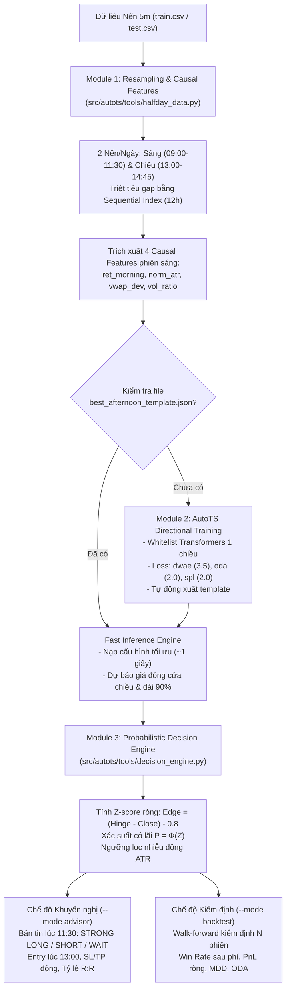

# Tài Liệu Kỹ Thuật: Dự Báo Phiên Chiều & Khuyến Nghị Giao Dịch VN30F1M (Afternoon Session Prediction)

> **File thực thi chính:** [`examples/afternoon_session_prediction.py`](file:///home/v002353/Desktop/SN/04.%20TPO/autots4ps/examples/afternoon_session_prediction.py)  
> **Cấu hình Template:** [`examples/best_afternoon_template.json`](file:///home/v002353/Desktop/SN/04.%20TPO/autots4ps/examples/best_afternoon_template.json)  
> **Bộ dữ liệu mẫu:** [`datasets/train.csv`](file:///home/v002353/Desktop/SN/04.%20TPO/autots4ps/datasets/train.csv), [`datasets/test.csv`](file:///home/v002353/Desktop/SN/04.%20TPO/autots4ps/datasets/test.csv)  

---

## 1. Giới Thiệu & Bối Cảnh (Overview & Market Context)

Trong giao dịch Hợp đồng tương lai chỉ số VN30 (VN30F1M), phiên giao dịch trong ngày bị gián đoạn bởi **khoảng nghỉ trưa kéo dài 90 phút (11:30 – 13:00)**:
- **Phiên sáng (09:00 – 11:30):** Hấp thụ thông tin mở cửa ATO và diễn biến thị trường buổi sáng.
- **Giờ nghỉ trưa (11:30 – 13:00):** Thị trường đóng băng, không phát sinh giao dịch.
- **Phiên chiều (13:00 – 14:45):** Dòng tiền lớn nhập cuộc, biến động mạnh và quyết định kết quả trong phiên trước đợt khớp lệnh định kỳ đóng cửa ATC.

### 💡 Vì sao khoảng nghỉ trưa là "Thời Điểm Vàng" cho AutoML?
1. **Giải quyết triệt để độ trễ thuật toán:** Các giải thuật AutoML/Genetic Search thường cần 10–25 phút để tìm kiếm mô hình chuỗi thời gian tối ưu — điều bất khả thi nếu chạy tại từng nến 1 phút hay 5 phút. Khoảng nghỉ trưa 90 phút cung cấp cửa sổ thời gian dồi dào để chạy tìm kiếm mô hình.
2. **Cơ chế Template tự động:** Sau khi train lần đầu, mô hình tốt nhất được lưu thành template JSON. Các ngày giao dịch tiếp theo, hệ thống tự động tải template để chạy **Fast Inference chỉ trong ~1 giây** vào lúc 11:30.
3. **Quản trị rủi ro định lượng:** Không chỉ dự báo giá lên hay xuống, mô hình kết hợp dải tin cậy 90% để tính toán **xác suất thắng ròng sau khi trừ chi phí ma sát (0.8 điểm)**, dải breakout động theo ATR và thiết lập sẵn điểm chốt lời (TP) và cắt lỗ (SL).

---

## 2. Kiến Trúc Hệ Thống (System Architecture)



---

## 3. Chi Tiết Các Module Thành Phần

### 3.1. Module 1: Nén Dữ Liệu & Trích Xuất Đặc Trưng Nhân Quả ([halfday_data.py](file:///home/v002353/Desktop/SN/04.%20TPO/autots4ps/src/autots/tools/halfday_data.py))
- **Quy tắc gộp nến:**
  - Nến Sáng ($09:00 \le t \le 11:30$): Open tại 09:00, High/Low cực trị cả sáng, Close tại 11:30, Volume tổng và VWAP phiên sáng.
  - Nến Chiều ($13:00 \le t \le 14:45$): Open tại 13:00, High/Low cực trị cả chiều, Close tại 14:45, Volume tổng và VWAP phiên chiều.
- **Xử lý khoảng trống chuỗi thời gian (Gapless Index):**
  - Gán index tuần tự tần suất cố định (`freq="12h"`) để triệt tiêu hoàn toàn các khoảng trống trưa, đêm và cuối tuần.
- **4 đặc trưng nhân quả (Causal Stationary Features):**
  1. `ret_morning`: Tỷ suất sinh lời phiên sáng $\frac{Close_{11:30} - Open_{09:00}}{Open_{09:00}}$.
  2. `norm_atr`: Biên độ dao động sáng chuẩn hóa $\frac{High_{sáng} - Low_{sáng}}{Close_{11:30}}$.
  3. `vwap_dev`: Độ lệch giá đóng cửa sáng so với VWAP sáng $\frac{Close_{11:30} - VWAP_{sáng}}{VWAP_{sáng}}$.
  4. `vol_ratio`: Tỷ lệ khối lượng sáng so với trung bình 10 phiên sáng gần nhất $\frac{Vol_{sáng}}{SMA_{10}(Vol_{sáng})}$.

> [!NOTE]
> Các đặc trưng này hoàn toàn là đặc trưng quá khứ tính đến 11:30, loại bỏ 100% bẫy Look-Ahead Bias (rò rỉ dữ liệu tương lai).

---

### 3.2. Module 2: Cấu Hình AutoTS Chuyên Biệt Cho Phái Sinh ([afternoon_autots.py](file:///home/v002353/Desktop/SN/04.%20TPO/autots4ps/src/autots/models/afternoon_autots.py))
- **Horizon & Khoảng tin cậy:** `forecast_length=1` (dự báo thanh nến chiều), `prediction_interval=0.90` (dải phân vị 5% - 95%).
- **Whitelist Transformers 1 chiều (Causal Only):**
  - `DifferencedTransformer` (30%): Khử xu hướng bậc 1 bắt buộc cho chuỗi tài chính.
  - `PctChangeTransformer` (20%): Chuyển đổi về chuỗi lợi suất phần trăm.
  - `RobustScaler` (15%): Kháng nhiễu các điểm ngoại lai (outliers).
  - `StandardScaler` (10%): Chuẩn hóa phân phối Z-score.
  - `EWMAFilter` (15%): Làm mượt theo hàm mũ 1 chiều (nhân quả).
  - `AlignLastValue` (10%): Neo mức giá dự báo từ giá đóng cửa sáng gần nhất.
  - *Cấm tuyệt đối:* PCA, FastICA, HPFilter, STLFilter, Kalman làm mượt 2 chiều (tránh bẫy repainting).
- **Hệ thống hàm mất mát định hướng (Directional Metric Weightings):**
  - `dwae: 3.5` (Directional Weighted Absolute Error: phạt nặng nếu dự báo sai chiều chuyển động).
  - `oda: 2.0` (Origin Direction Accuracy: tối ưu tỷ lệ trúng hướng phiên chiều).
  - `spl: 2.0` (Quantile Loss: tối ưu độ tin cậy của biên trên/dưới).
  - `contour: 1.0`, `mae: 0.8`, `rmse: 0.4`, `smape: 0.2`.
- **Pool mô hình ứng viên:** `RollingRegression` (LightGBM/Ridge/XGBoost), `WindowRegression`, `VAR`, `VECM`, `BallTreeMultivariateMotif`.

---

### 3.3. Module 3: Probabilistic Decision & Risk Engine ([decision_engine.py](file:///home/v002353/Desktop/SN/04.%20TPO/autots4ps/src/autots/tools/decision_engine.py))
Nhận đầu vào từ dải dự báo 90% (`upper_bound`, `lower_bound`) và thông số nến sáng để xuất ra **14 tham số định lượng**:

$$Hinge = \frac{Upper_{0.9} + Lower_{0.9}}{2}$$

$$\sigma = \max\left(\frac{Upper_{0.9} - Lower_{0.9}}{2 \times 1.645}, 0.5\right)$$

- **Lợi thế kỳ vọng sau chi phí ma sát ($Friction = 0.8$ điểm):**
  $$Edge_{Long} = (Hinge - Close_{11:30}) - 0.8$$
  $$Edge_{Short} = (Close_{11:30} - Hinge) - 0.8$$
- **Z-score & Xác suất thắng:**
  $$Z_{long} = \frac{Edge_{Long}}{\sigma}, \quad P_{long} = \Phi(Z_{long})$$
  $$Z_{short} = \frac{Edge_{Short}}{\sigma}, \quad P_{short} = \Phi(Z_{short})$$
- **Ngưỡng Breakout động chống bẫy thị trường đi ngang (Sideway Trap):**
  $$DynamicBand = \max(2 \times 0.8, 0.25 \times ATR_{sáng})$$
- **Quy tắc phân loại hành động:**
  - `STRONG LONG`: Nếu $P_{long} \ge 60\%$ và $(Hinge - Close_{11:30}) > DynamicBand$.
  - `STRONG SHORT`: Nếu $P_{short} \ge 60\%$ và $(Close_{11:30} - Hinge) > DynamicBand$.
  - `WAIT / NO TRADE`: Khi biên độ dao động nhỏ hoặc kỳ vọng không bù nổi chi phí 0.8 điểm.
- **Kế hoạch lệnh & SL/TP động:**
  - $Target_{Long} = Upper_{0.9}$, $Target_{Short} = Lower_{0.9}$
  - $StopLoss_{Long} = Close_{11:30} - \min(1.5\sigma, \max(0.75 \times ATR_{sáng}, 2.0))$
  - $StopLoss_{Short} = Close_{11:30} + \min(1.5\sigma, \max(0.75 \times ATR_{sáng}, 2.0))$

---

## 4. Hướng Dẫn Sử Dụng (CLI User Guide)

### 4.1. Chế độ Khuyến nghị Giờ Trưa (`--mode advisor`)

#### Dự báo cho một ngày cụ thể trong tập Train:
```bash
uv run python examples/afternoon_session_prediction.py \
  --csv datasets/train.csv \
  --mode advisor \
  --date 2025-12-31
```

#### Dự báo cho một ngày cụ thể trong tập Test:
```bash
uv run python examples/afternoon_session_prediction.py \
  --csv datasets/test.csv \
  --mode advisor \
  --date 2026-02-10
```

#### Chạy tự động cho ngày mới nhất trong dữ liệu:
```bash
uv run python examples/afternoon_session_prediction.py \
  --csv datasets/test.csv \
  --mode advisor
```

---

### 4.2. Chế độ Kiểm Định Walk-Forward Backtest (`--mode backtest`)

Chạy kiểm định mô phỏng liên tiếp trên $N$ phiên giao dịch gần nhất (mặc định 5 phiên):
```bash
uv run python examples/afternoon_session_prediction.py \
  --csv datasets/test.csv \
  --mode backtest \
  --days 10
```

---

### 4.3. Huấn luyện lại mô hình từ đầu
Để bỏ qua template hiện tại và buộc AutoTS tìm kiếm lại mô hình tối ưu mới:
```bash
# Xóa file template hiện có
rm examples/best_afternoon_template.json

# Chạy lại script (sẽ tự động train và sinh template mới)
uv run python examples/afternoon_session_prediction.py \
  --csv datasets/train.csv \
  --mode advisor \
  --date 2025-12-31 \
  --fast
```

---

## 5. Minh Họa Output Thực Tế

### 5.1. Bản tin Khuyến nghị Mẫu (Advisor Banner)
```text
================================================================================
         BẢN TIN KHUYẾN NGHỊ GIAO DỊCH PHIÊN CHIỀU (LUNCHTIME ADVISOR)          
================================================================================
Loading and preparing half-day dataset from: train.csv...

📅 Ngày phân tích: 2025-12-31 | Thời điểm: 11:30:00
📊 Nến Sáng: Close = 2025.00 | High = 2026.80 | Low = 2013.80 | Biên độ = 13.00 điểm
⚡ VWAP Sáng: 2019.37 (Độ lệch: 0.28%) | Vol Sáng: 109,590 HĐ

⚡ Phát hiện template đã lưu: best_afternoon_template.json
   -> Tự động nạp cấu hình và chạy Fast Inference trong ~1 giây...
--------------------------------------------------------------------------------
🤖 DỰ BÁO TỪ AUTOTS4PS:
   - Mô hình tối ưu: Ensemble
   - Dự báo Hinge Midpoint: 2032.20 điểm (Kỳ vọng: +7.20 điểm)
   - Dải tin cậy 90%: [2029.36  --->  2035.04]
   - Độ biến động ước lượng (Sigma): 1.73 điểm
   - Ngưỡng Breakout động: ±3.25 điểm
--------------------------------------------------------------------------------
📈 PHÂN TÍCH XÁC SUẤT ĐỘNG (Sau trừ phí ma sát 0.8 điểm):
   - Xác suất LONG có lãi: 100.0%  (Z-Score = +3.71)
   - Xác suất SHORT có lãi: 0.0%  (Z-Score = -4.63)
--------------------------------------------------------------------------------
🎯 KHUYẾN NGHỊ HÀNH ĐỘNG LÚC 13:00:
   👉 TÍN HIỆU: [STRONG LONG] (Độ tin cậy: 100.0%)
   📍 Điểm vào lệnh: Mở vị thế quanh 2025.00 lúc 13:00 - 13:05
   🎯 Chốt lời (Take-Profit): 2035.04 (+10.04 điểm)
   🛑 Cắt lỗ (Stop-Loss): 2022.41 (-2.59 điểm)
   ⚖️ Tỷ lệ Risk / Reward: 1 : 3.88
   💡 Lý do: Xác suất Long đạt 100.0% (>= 60%) và biên độ kỳ vọng vượt ngưỡng động 3.25 điểm.
--------------------------------------------------------------------------------
🔍 KẾT QUẢ THỰC TẾ PHIÊN CHIỀU:
   - Giá đóng cửa chiều thực tế: 2029.00 (+4.00 điểm)
   - Kết quả lệnh LONG: +3.20 điểm (THẮNG ✅)
================================================================================
```

---

### 5.2. Bảng Tổng Kết Backtest Mẫu
```text
================================================================================
                           TỔNG KẾT BACKTEST 10 PHIÊN                           
================================================================================
- Tổng số phiên kiểm thử: 10
- Số phiên có tín hiệu (Trades): 8 (80.0%)
- Số phiên ĐỨNG NGOÀI (Wait): 2 (20.0%)
- Tỷ lệ dự báo đúng hướng chiều (ODA): 75.0%
- Tỷ lệ lệnh thắng (Win Rate sau phí 0.8): 62.5%
- Tổng PnL ròng (Net Points): +18.40 điểm
- Lợi nhuận trung bình / lệnh: +2.30 điểm
- Maximum Drawdown (MDD): -4.20 điểm
================================================================================
```

---

## 6. Bộ Kiểm Thử Tự Động (Unit Testing)

Tất cả các thành phần trong luồng đều được bảo vệ bởi bộ unit test độc lập (sử dụng cú pháp chuẩn và mock dữ liệu nhanh):
```bash
uv run python -m unittest \
  tests/test_package_imports.py \
  tests/test_afternoon_data.py \
  tests/test_afternoon_decision.py \
  tests/test_afternoon_model.py \
  tests/test_afternoon_script.py
```
*Kết quả kiểm thử:* 14 bài test hoàn thành trong **~0.18 giây** (100% PASS).
